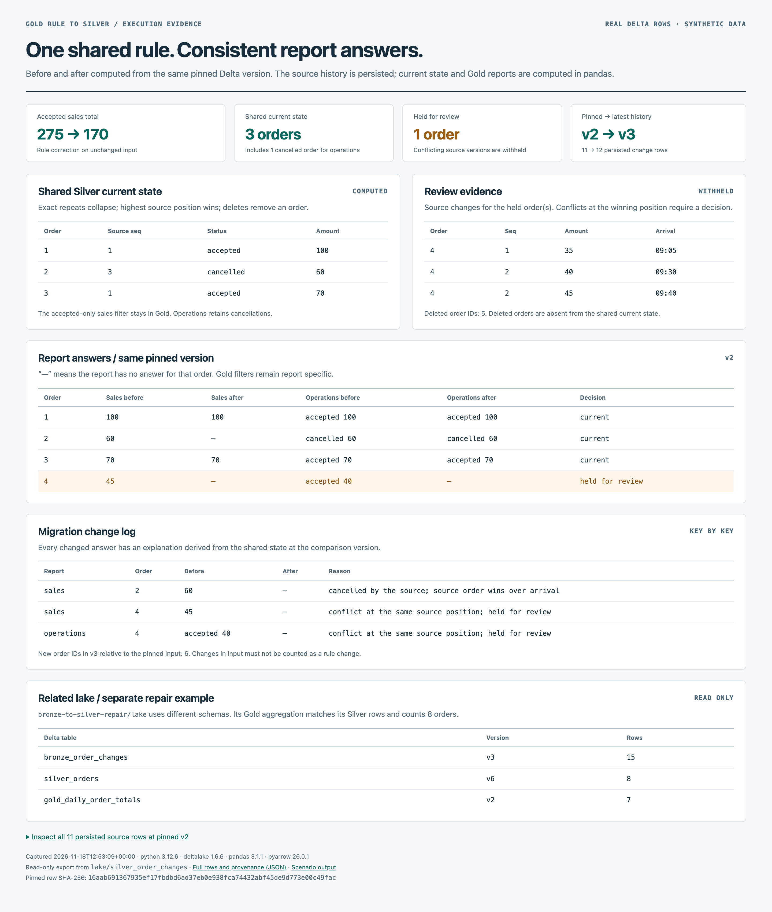
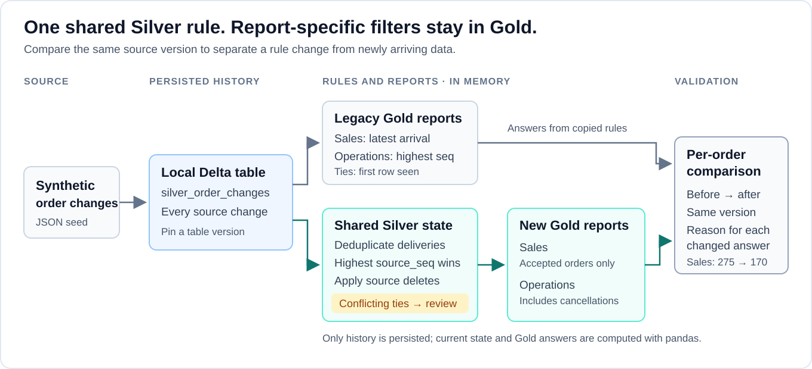

# Gold Rule to Silver

**Move duplicated order cleanup logic from Gold reports into one shared Silver rule, and explain every changed answer on a pinned Delta Lake version.**

Companion implementation for **Why Does Every Gold Table Clean the Same Rows?** This project demonstrates a controlled migration: resolve source changes once, preserve each report's business filters, and compare results order by order before moving readers.

The example uses synthetic data and real local Delta tables through `deltalake` (delta-rs). It runs with Python and pandas; Spark and a Databricks workspace are not required.

## Quick start

Requirements: **Python 3.10+**, `pip`, and Bash. Initial installation requires access to the Python package index.

```bash
./run_demo.sh
```

The script creates `.venv`, installs dependencies, runs the tests, and prints the scenario results. Alternatively:

```bash
python3 -m venv .venv
.venv/bin/python -m pip install -r requirements.txt
.venv/bin/python -m pytest
.venv/bin/python -m src.silver_rule_demo
```

Generated data lives in `lake/silver_order_changes/`; `lake/run.json` records the run's versions and seed checksum. Reruns replace the current contents of **that demo table**, append the later arrival, and retain Delta history and unrelated files. Reserve that table name and manifest for this demo. On a new table the comparison uses v0 and the later arrival creates v1; version numbers increase on subsequent runs.

## Results from a real run



The architecture uses a scalable vector diagram, and the result image is a high-resolution Chrome capture of the generated [HTML evidence report](docs/results/index.html), built by reading versioned Delta rows. The data is synthetic; the table reads and calculated results are real. Inspect the [full rows and provenance](docs/results/tables.json) or the [scenario output](docs/results/demo.txt).

| Observation | Before | After the shared rule |
| --- | --- | --- |
| Order 2 | Sales counts **60**; operations says **cancelled 60** | Cancellation wins by source position; sales excludes it and operations retains it |
| Order 4 | Sales counts **45**; operations shows **accepted 40** | Conflicting changes at the winning position are held for review |
| Accepted sales total | **275** | **170** |
| Shared current state | Each report chooses separately | Orders **1, 2, 3**; order **4** held; order **5** deleted |
| Comparison against a newer version | Same initial input | Order **6** adds a data change, demonstrating why the migration must pin its input |
| Operations cancellations | **1** with the filter in Gold | Would become **0** if sales' accepted-only filter moved into Silver |

### Reproduce the evidence

Run the demo first, then export its existing snapshots and capture the result:

```bash
.venv/bin/python -m src.inspection
.venv/bin/python scripts/capture_snapshot.py
```

The exporter is **read only against the lake**. It writes `index.html`, `tables.json`, and `demo.txt` under `docs/results/`. It uses the pinned version in `lake/run.json`; pass `--pinned-version N` to inspect a different version or a table without a manifest.

The screenshot helper requires local Chrome or Chromium. Use `CHROME_BIN` or `--browser` for a custom executable. It supports `--width`, `--height`, and `--scale`. The HTML opens locally without a server or network assets. When viewed on GitHub, download the HTML to open it, or inspect the PNG and JSON directly.

```bash
make results       # Export existing Delta snapshots
make snapshot      # Export, then capture the HTML with Chrome/Chromium
```

## Architecture



Both legacy reports and the shared rule read **the same pinned history version**. The scenario computes `CurrentState` once per snapshot and passes that object to both new reports. A second version demonstrates how new arrivals can contaminate a migration comparison.

| Responsibility | Implementation |
| --- | --- |
| Choose the current version of an order | [`rules.py`](src/rules.py): deduplicate, order by source position, apply deletes, withhold conflicts |
| Decide what a report counts | [`reports.py`](src/reports.py): sales accepts only accepted orders; operations includes cancellations |
| Explain changed report answers | [`compare.py`](src/compare.py): compare keys and assign a reason using the state at that version |
| Store and read versioned history | [`repository.py`](src/repository.py): Delta adapter implementing `ChangeStore` |
| Coordinate the migration example | [`scenario.py`](src/scenario.py): injected seed and storage contract |
| Wire the local runtime | [`silver_rule_demo.py`](src/silver_rule_demo.py): paths, seed loading, Delta adapter, run manifest, terminal output |
| Export inspectable evidence | [`inspection.py`](src/inspection.py): read-only Delta inspection, HTML, JSON, and transcript |

**Persistence boundary:** only `silver_order_changes` is a Delta table in this project. The shared current state, review list, migration change log, and Gold answers are computed in memory. The architecture does not imply persisted Silver current-state or Gold tables.

## Data and rule semantics

[`data/order_changes.json`](data/order_changes.json) contains **11 initial changes** for orders 1–5 and **one later change** for order 6. See the [seed timeline](data/README.md).

| Field | Meaning |
| --- | --- |
| `order_id` | Integer order identifier |
| `source_seq` | Position of the change in the source; a higher value is later |
| `op` | `upsert` or `delete` |
| `status` | `accepted` or `cancelled`; null for a delete |
| `amount` | Whole-number amount; null for a delete |
| `arrived_at` | Pipeline arrival time as an `HH:MM` string, within this single-day example |

The shared rule collapses repeat deliveries with the same order, position, operation, status, and amount. It then considers each order's highest source position. One unambiguous upsert becomes current; a delete removes the order. Different changes at the winning position place the order in `exceptions`. An older conflict does not block a later unambiguous version.

The two legacy rules illustrate the problem: sales picks the last arrival, while operations picks the highest source position and keeps the first row seen on a tie. Neither is the shared conflict policy.

## Related Bronze → Silver repair lake

The supplied `../bronze-to-silver-repair/lake` is a **separate example**. Its persisted Bronze, Silver, and Gold tables use different schemas from this project's order change log. It is useful for viewing physical layer outputs, but it is not input to this migration scenario.

The attached evidence also includes a read-only inspection of that lake:

| Table | Inspected version | Rows |
| --- | --- | --- |
| `bronze_order_changes` | **3** | **15** events |
| `silver_orders` | **6** | **8** orders |
| `gold_daily_order_totals` | **2** | **7** groups |

Its Gold aggregation matches its Silver rows and counts **8 orders**. These are captured observations; rerunning the other project may change its versions and rows. Full records are included under `related_lake` in [tables.json](docs/results/tables.json).

To include that optional lake in a new export:

```bash
.venv/bin/python -m src.inspection \
  --related-lake ../bronze-to-silver-repair/lake
.venv/bin/python scripts/capture_snapshot.py
```

This command does not modify either lake. The three related tables are read at their individual captured versions; pause their writers when cross-table consistency matters.

## Development

```bash
make               # Install development tools; lint, format check, types, tests, demo
```

| Command | Purpose |
| --- | --- |
| `make setup` | Create `.venv`; install runtime dependencies, pytest, Ruff, and mypy |
| `make test` | Run the test suite |
| `make lint` | Check lint and formatting |
| `make types` | Run `mypy src` |
| `make demo` | Run the Delta-backed example |
| `make results` | Export existing lake evidence without rerunning the demo |
| `make snapshot` | Export evidence and capture the report |
| `make clean` | Remove `.venv`, the entire generated `lake/` directory, and tool caches |

After setup, tools can also be invoked directly with `.venv/bin/python -m pytest`, `-m ruff check .`, `-m ruff format --check .`, and `-m mypy src`.

```text
data/                   Synthetic source changes and their timeline
src/
  models.py             CurrentState and Change value objects
  protocols.py          Generic Report and versioned ChangeStore contracts
  rules.py              Legacy selectors and shared Silver policy
  reports.py            Sales and operations before/after reports
  compare.py            Per-order comparison and explanations
  repository.py         Local Delta adapter
  scenario.py           Storage-independent orchestration
  silver_rule_demo.py    CLI composition root and run manifest
  inspection.py         Read-only evidence exporter
tests/                  Unit, contract, and Delta integration checks
scripts/                Browser screenshot helper
docs/architecture.svg   Editable vector architecture diagram
docs/results/           Committed PNG, HTML, JSON, and terminal evidence
```

## Scope

This is a correctness example over six synthetic orders, with all reads materialized in pandas. It does not benchmark scale, persist the shared current state, route review exceptions, discover downstream readers, or execute Databricks AUTO CDC, expectations, or Unity Catalog lineage. A production migration needs those operational decisions and explicit data-contract validation.

All example data is synthetic. The repository currently has no `LICENSE` file and declares no reuse license.
