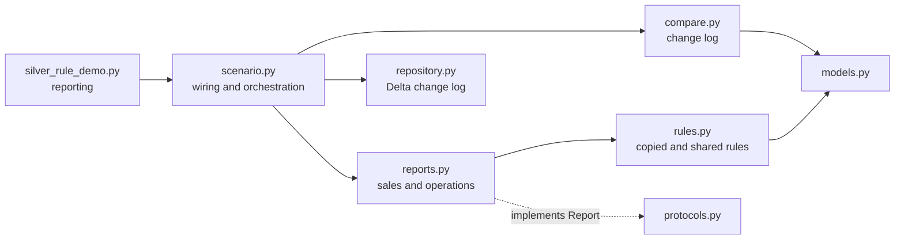

# Gold Rule to Silver

**Move a cleanup rule that every Gold report copies into one shared Silver rule, without changing reports by surprise, with an executable local Delta Lake example.**

Companion code for **Why Does Every Gold Table Clean the Same Rows?** A sales report and an operations report both pick "the current version of each order" from the same Silver table, each with its own copy of the rule. For one order, sales counts 60 and operations says it was cancelled. The project moves the rule into Silver once, holds back an order it cannot decide, compares old and new answers key by key on one pinned version, and keeps each report's own filter in Gold.

Silver here keeps **every change the source sent**, in arrival order. Each change carries a **source position** (`source_seq`), the order in which the source made the changes, and an arrival time, when the pipeline received it. Gold is the reports built on top. The shared rule produces a **current state**: one row per order.

The example uses synthetic order data, Python, pandas, and the open-source `deltalake` library (delta-rs). It runs locally without Spark or a Databricks workspace.

## Place each rule

| Rule | Belongs in | Local implementation |
| --- | --- | --- |
| **What one order is** (its current version) | Silver, once | [`current_state`](src/rules.py): repeats count once, the highest source position wins, deletes remove the order, and two different changes at the winning position are held for review. |
| **What one report counts** | Gold, in that report | [`SalesAfter`](src/reports.py) keeps its accepted-only filter; [`OperationsAfter`](src/reports.py) shows cancelled orders on purpose. |
| **How a reader moves** | The migration, with a change log | [`change_log`](src/compare.py) compares old and new answers on one pinned Silver version and gives each change a reason. |

The two copied rules are kept as counterexamples: [`latest_by_arrival`](src/rules.py) (the last change to arrive wins) and [`latest_by_position_first_seen`](src/rules.py) (the highest position wins, and on a tie the first row read).

**Implementation scope:** Silver's change log is a real Delta table on local disk, and the pinned comparison uses its table versions. The shared rule, the reports, and the change log are pure pandas computed in memory; no current-state table or Gold table is persisted. Databricks AUTO CDC, pipeline expectations, and Unity Catalog lineage are not executed.

## Quick start

Requirements: **Python 3.10+**, `pip`, and Bash for the helper script. The first setup requires access to the Python package index. `make` is optional.

Run from the repository root:

```bash
./run_demo.sh
```

The script creates `.venv` if needed, installs `requirements.txt`, runs the tests, and prints the scenario results. `deltalake` is pinned to `1.6.6`; the other dependencies have minimum versions.

The demo deletes and recreates the repository's `lake/` directory on each run. Keep that directory reserved for generated demo data. The Python helper `run(lake)` likewise removes the directory passed to it.

To run the same steps manually:

```bash
python3 -m venv .venv
.venv/bin/python -m pip install -r requirements.txt
.venv/bin/python -m pytest
.venv/bin/python -m src.silver_rule_demo
```

### Development commands

| Command | Action |
| --- | --- |
| `make` | Run lint, formatting checks, type checks, tests, and the demo. |
| `make setup` | Create `.venv` and install runtime and development tools. |
| `make test` | Run `pytest`. |
| `make lint` | Run `ruff check` and `ruff format --check`. |
| `make types` | Run `mypy src`. |
| `make demo` | Print the demo results. |
| `make clean` | Remove `.venv`, `lake/`, tool caches, and Python bytecode caches. |

The check and demo targets run dependency setup first. Once dependencies are installed, invoke tools directly with `.venv/bin/python -m pytest`, `.venv/bin/python -m ruff check .`, `.venv/bin/python -m ruff format --check .`, or `.venv/bin/python -m mypy src`.

## What the example demonstrates

Silver's first load holds every change for orders 1 to 5. Order **2** was updated at position 2 and cancelled at position 3, but position 2 arrived late, after the cancellation. Order **3** was delivered twice. Order **4** has two different changes at the same position 2. Order **5** was created and then deleted. Order **6** arrives in a later commit.

| Step | Expected result |
| --- | --- |
| Run both reports with their own copy of the rule | For order 2, sales counts **60** (the late arrival wins) while operations shows it **cancelled**. For order 4, sales picks **45** and operations picks **40**. |
| Apply the shared Silver rule | Current state: orders 1, 2 (cancelled), and 3. Order **4** is held for review. Order 5 is removed. |
| Point both reports at the shared state and compare on the same Silver version | Sales loses orders 2 and 4; operations loses order 4. The sales total goes from **275** to **170**, and every change has a reason. |
| Compare against a newer Silver version instead | Order **6** appears as a third change. It is new data, not a rule change. |
| Move the sales report's accepted-only filter into Silver too | Operations would lose its cancelled order: its cancelled count goes from **1** to **0**. The filter stays in Gold. |

The executable prints all outcomes. [`test_article_claims.py`](tests/test_article_claims.py) checks the reported values against a real temporary Delta table.

## Example output

The following successful `./run_demo.sh` run passed all **8 tests** and printed the results below. Test timing varies by machine; package installation and update notices are omitted.

```text
$ ./run_demo.sh
{out}
```

## Data and change semantics

Each Silver row is one change:

| Field | Meaning |
| --- | --- |
| `order_id` | Integer order identifier. |
| `source_seq` | The source's position for the change. Higher means later in the source. |
| `op` | `upsert` or `delete`. |
| `status` | `accepted` or `cancelled`; `null` for a delete. |
| `amount` | Whole-number amount; `null` for a delete. |
| `arrived_at` | When the pipeline received the change, as an `HH:MM` string. |

[`current_state`](src/rules.py) first drops exact repeats (same order, position, operation, status, and amount). It then keeps the rows at each order's highest position. One row there is the order's current version, unless it is a delete; two or more different rows are a conflict, and the order is listed in `exceptions` instead of being guessed.

Reports answer with one value per order: sales gives the amount of accepted orders, operations gives "status amount" for every order it shows. [`change_log`](src/compare.py) lists every order whose answer differs and explains it from the shared state: a conflict, a cancellation, a delete, or new data. The reasons come from these rules; in a real migration, each one is a claim the report owner should check against a few real orders.

See [`data/README.md`](data/README.md) for the seed fields and timeline.

## Architecture and SOLID assessment



The code broadly follows SOLID at the scale of a teaching project, with specific gaps:

| Principle | Assessment |
| --- | --- |
| **Single responsibility** | What an order is (`rules.py`), what a report counts (`reports.py`), why an answer changed (`compare.py`), persistence, orchestration, and reporting are separate modules. |
| **Open/closed** | A new report is a new class with `name` and `answer`; the scenario treats every report through the `Report` interface. |
| **Liskov substitution** | The before and after reports share the `Report` contract and return one answer per order. The answer types differ by report (an amount or a status string), so callers must not assume one shape. |
| **Interface segregation** | `Report` has one method. The storage adapter has no interface of its own; the scenario uses the Delta class directly. |
| **Dependency inversion** | Rules, reports, and the change log are pure pandas and never import `deltalake`. Only `scenario.py` creates the Delta table. The "after" reports call `current_state` directly instead of receiving the shared state, so they recompute it rather than read it. |

The current structure is useful for the example. Before broadening it, persist the current state as its own table, pass it to the reports instead of recomputing it, and give the change-log store an interface with an in-memory fake.

## Repository layout

```text
.
├── data/
│   ├── order_changes.json   # Synthetic order changes, plus one later arrival
│   └── README.md            # Seed fields and timeline
├── src/
│   ├── models.py            # CurrentState and Change value objects; column names
│   ├── protocols.py         # Report interface
│   ├── rules.py             # The two copied rules and the shared Silver rule (pure pandas)
│   ├── reports.py           # Sales and operations, before and after
│   ├── compare.py           # Key-by-key change log with reasons
│   ├── repository.py        # Silver order changes as a local Delta table
│   ├── scenario.py          # Example orchestration and structured results
│   └── silver_rule_demo.py  # Composition root and printed report
├── tests/
│   ├── conftest.py               # Temporary Delta scenario fixture
│   ├── test_article_claims.py    # End-to-end checks of the example results
│   └── test_rules.py             # Shared rule and change-log reasons without storage
├── Makefile
├── pyproject.toml
├── requirements.txt
└── run_demo.sh
```

## Scope and limitations

- **Local demonstration:** all reads are materialized in pandas. Six synthetic orders illustrate correctness, not throughput or cost.
- **No persisted current state:** the shared rule is computed in memory on each read. A real migration would materialize it as a Silver model beside the change log, not replace a history readers depend on.
- **Conflict policy:** two different changes at the same position are held back and listed. The rule does not decide them, and nothing here routes the list to an owner.
- **One-row-per-order check:** the rule guarantees one row per order by construction. A real table needs its own test that counts keys, because per-record checks such as pipeline expectations cannot see across rows.
- **Reader discovery:** the two reports are known in advance. Finding real readers, for example through Unity Catalog lineage, and moving them one at a time are outside the code.
- **Engine scope:** the rule is plain pandas over a local Delta table. It does not establish how Databricks AUTO CDC orders changes or breaks ties.

## Data and license

All example data is synthetic. No `LICENSE` file is included, and the repository does not currently declare a reuse license.
